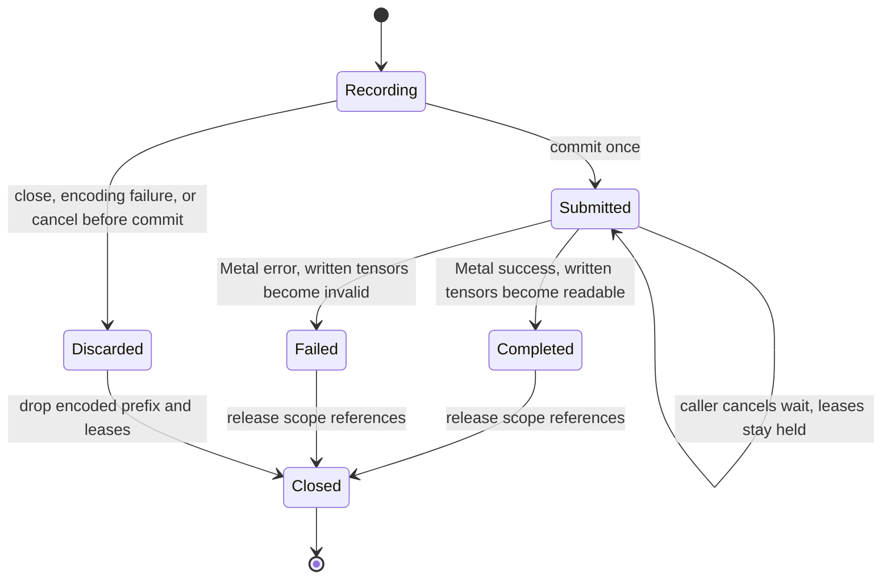

# ADR: Experimental Metal tensors

**Status** · Proposed for review in GPU roadmap NN-01. The owner has approved a
separate experimental package boundary.

**Inspected source** · `main` at `eeaf7d8893fa56f7beb7cc800f30b22e7d30ba26`
(`v0.10.21`). The older CPU tensor roadmap uses the same task numbers.

## Decision

Introduce `github.com/itsmontoya/neuralnetwork/gpu` as an explicit device
tensor API, backed by the existing `internal/device` Metal runtime. Callers
request the default Metal device, own device tensors, group operations in
scopes, and choose when to transfer or wait. The first consumer is Llama.
Neuralnetwork owns the device operations and resource lifetime. Llama owns
model loading, decoder sequencing, and session state such as KV cache
positions. Revisit the package boundary after full FP32 inference works and
has been measured and optimized.

The existing [CPU tensor contract](tensor-design.md) stays in force.
`tensor.Tensor` owns contiguous host storage, supports FP32 and int64, and
copies shape and public value slices. In a Metal build,
[`tensor/matrix_product.go`](../tensor/matrix_product.go) adapts products
through copied matrices and observes the result with `Values`. Other builds
use the [host product path](../tensor/matrix_product_host.go). Both return
host-owned tensors. The CPU's
[`PreparedRightTranspose`](../tensor/prepared_right_transpose.go) can use
an ARM64-specific weight layout. Upload logical row-major values through the
GPU API.

## What exists and where it can be reused

| Source | Observed behavior and reuse boundary |
| --- | --- |
| [`runtime.go`](../internal/device/runtime.go), [`backend.go`](../internal/device/backend.go), [`backend_default.go`](../internal/device/backend_default.go) | `SharedRuntime` constructs one process-wide Go wrapper. The portable backend reports unavailability and carries no cgo dependency. A successful `SharedRuntime` probe also sets the ANN dispatch readiness flag. Share the underlying runtime with `gpu` through a private acquisition path that preserves when ANN marks this flag ready. |
| [`backend_metal.go`](../internal/device/backend_metal.go), [`metal_backend.h`](../internal/device/metal_backend.h), [`metal_backend.m`](../internal/device/metal_backend.m) | The cgo shim links Foundation and Metal. Under a native initialization mutex, `MTLCreateSystemDefaultDevice` supplies one device and `newCommandQueue` supplies one queue. `newLibraryWithSource:options:error:` compiles embedded MSL with default options. The runtime eagerly creates and retains eleven named compute pipelines. It caches success, no device, or an initialization failure for the process. Partial initialization releases acquired resources. The ready device, queue, library, and pipelines have process lifetime. Reuse this owner and the existing compute fill and blit copy. |
| [`buffer.go`](../internal/device/buffer.go), [`metal_backend.m`](../internal/device/metal_backend.m) | `Runtime.NewBuffer` checks a positive FP32 count and byte overflow. Native allocation checks `NSUInteger` and allocates an owned `MTLBuffer` with `MTLResourceStorageModeShared`. Upload and download use full-buffer synchronous `memcpy` during the cgo call. `Buffer.Release` drops the owner's native reference and frees the C record. The Go buffer mutex serializes host operations and release. Reuse allocation and transfers behind GPU access and lifetime checks. |
| [`scope.go`](../internal/device/scope.go), [`metal_backend.m`](../internal/device/metal_backend.m) | `Runtime.NewScope` retains one command buffer from the shared queue. Each operation creates and ends a blit or compute encoder. The native scope retains the referenced `MTLBuffer` objects separately from the C buffer records. A scope mutex serializes its methods, and independent scopes use independent command buffers. `Commit` submits once, `Completed` polls, and `Wait` blocks. `Release` discards unsubmitted commands or waits as needed for submitted work, then drops native scope references. Reuse these primitives underneath GPU scope state and access tracking. |
| [`resource_snapshot.go`](../internal/device/resource_snapshot.go), [`metal_backend.m`](../internal/device/metal_backend.m) | Native counters track buffer records and requested bytes, scopes, submissions, and observed completions under a separate mutex. Reset requires zero live buffer records and scopes. A native scope can still retain an allocation after a buffer record is released, so these counts are aggregate ownership diagnostics and omit some retained bytes and driver overhead. Use scoped accounting for future GPU benchmarks. |
| [`residency.go`](../internal/device/residency.go), [`execution.go`](../internal/device/execution.go), [`execution_adapter.go`](../internal/device/execution_adapter.go), [`publication.go`](../internal/device/publication.go), [`boundary.go`](../internal/device/boundary.go), [`dispatch.go`](../internal/device/dispatch.go) | Keep these with ANN policy. Residency tracks logical, host, device, and pending revisions, reuses current buffers, stages device writes, and restores the committed state on failure. It has finalizer cleanup tied to matrix lifetime. Execution binds matrices through an adapter, with batch rotation at 64 kernels or a 64 MiB transient-data budget. It commits, waits and releases before publishing staged writes. Host barriers cover observations, mutations and CPU fallback. The dispatch thresholds are `1 << 26` cold and `1 << 22` ready scalar multiplications. GPU tensors have one authoritative device buffer and explicit access boundaries. |

Three findings delimit safe reuse:

1. The native retain begins during encoding. `Scope.validateBuffer` reads
   the Go buffer's release flag and handle under the scope mutex alone.
   `Buffer.Release` uses a different mutex and can free the native record.
   The existing retention test releases the buffer after encoding. A GPU
   facade must acquire a buffer lease before validation or encoding can race
   with closure, then hold it through command completion or discard. This
   can be done with private tensor state that is the sole owner of its Go
   buffer.
2. Full-buffer copies through `contents` have no GPU hazard tracking. Shared
   storage still requires completed CPU writes before GPU access and
   completed GPU writes before CPU access. `Scope` checks runtime identity
   and some counts, while individual ops require their own shape, alias,
   and index-width checks. For example, `EncodeMatMul` validates flattened
   counts, and the ANN adapter supplies conforming inner and output
   dimensions. The shader performs row-major indexing with MSL `uint`.
   [Apple's shared-storage contract](https://developer.apple.com/documentation/metal/mtlstoragemode/shared?language=objc)
3. The native diagnostic is thread-local. The Go shim currently reads it
   through a second cgo call, which may execute on a different OS thread.
   Preserve error context across this boundary by returning status and
   diagnostics in one call, or pinning the error-producing call and retrieval
   together as a narrow private change. Native `Wait` reports command status
   and localized errors. The fault test injects an error after Metal
   completes work, which is why failure cannot imply that bytes stayed
   unchanged.

These changes can be confined to private lifetime, acquisition, and bridge
code and the experimental facade. If implementation requires changing an
existing ANN public contract, stop for owner review with a migration design.

## Existing ANN behavior

[`Sequential`](../model/sequential.go) keeps transparent Matrix execution
for the supported Dense → ReLU → Dense → Softmax graph. Prediction and
backpropagation can keep intermediates resident. Training uses the resident
categorical cross entropy and direct SGD path when eligible. Keep
[`model/execution_eligibility_metal.go`](../model/execution_eligibility_metal.go),
[`matrix/execution.go`](../matrix/execution.go),
[`matrix/residency.go`](../matrix/residency.go),
[`matrix/metal.go`](../matrix/metal.go) and the
[`forward`](../matrix/forward_device_metal.go),
[`backward`](../matrix/backward_device_metal.go),
[`training`](../matrix/training_device_metal.go) and
[`copy`](../matrix/copy_metal.go) adapters on their current path. Small or
unsupported work and missing devices use the existing CPU path. The adapters
surface initialization failures and errors after an eligible device attempt.
Matrix observation can synchronize and download a newer value. CPU
fallback, parameter mutations, serialization, and scratch reuse retain their
current barriers and coherence. The GPU API does not change
[`InferenceSession`](../model/inference_session.go) ownership or sharing
rules. See the [ANN Metal design](metal.md) for the public operation boundaries.

## Proposed tensor and execution contract

- The first supported GPU target is macOS ARM64 with cgo and the `metal` tag.
  Existing ANN native sources use `darwin && cgo && metal && !purego`,
  with the complementary portable build constraints. Keep those constraints
  for ANN. The experimental package should compile everywhere and return a
  stable unavailable error when its build is disabled, its platform is
  unsupported, or the enabled runtime has no default Metal device. Preserve
  separate initialization diagnostics for a detected runtime that fails to
  start. A GPU request never implicitly selects CPU. Initial selection is
  explicit opt-in to the system default. The API needs no enumeration.
- A tensor owns one contiguous row-major FP32 allocation on the device handle
  that created it. Copy shape metadata on input and observation. Initially
  admit rank one or higher with positive dimensions. Reject malformed or
  unsupported shapes before allocating. Check element and byte products,
  host index limits, native length conversion, the device's
  [maximum buffer length](https://developer.apple.com/documentation/metal/mtldevice/maxbufferlength),
  and operation-specific shader limits before crossing the bridge. Report
  allocation failure for a valid size that cannot be allocated.
- Upload copies caller data before returning. Download writes to a
  caller-owned slice of the exact length and reads a completed, initialized
  buffer. Transfers fail as busy while a scope holds a lease on the tensor.
  The caller chooses when to wait. A new destination becomes readable after
  a complete upload or successful full GPU write. A later operation in the
  same scope may read an earlier write in encode order. Normal operations
  issue no CPU readback.
- Each scope records on one command buffer and supports ordered operations
  followed by one explicit submission. Start with whole-buffer read and write
  leases, acquired together for every new operation. Scope leases can share
  a tensor for reading and reject competing writers. A scope owns its mutable
  destinations through completion and rejects tensors from another logical
  device handle. Use disjoint mutable activations per session and share
  read-only weights through the same device handle.
- `Tensor.Close` immediately prevents new uses and defers releasing the Go
  buffer owner until its last lease ends. Logically open tensors can outlive
  the scope that wrote them. `Scope.Close` discards recording work or drains
  a submission before releasing resources. `Device.Close` returns busy while
  live tensors or scopes remain and succeeds when they have closed. Closing
  an idle device handle leaves the process runtime available to other users.
  Close is idempotent after success.
- Check context cancellation before submission and discard recorded work when
  cancellation wins. After commit, context cancellation ends the caller's
  wait. Submitted work still reaches a terminal Metal status. Leases and
  pending outputs remain until a later wait or a draining close observes
  success or failure. A backend command failure marks affected destinations
  unreadable until a new full write succeeds. A validation or encoding failure
  after earlier commands poisons the proposed scope. Only close/discard is
  valid and the encoded prefix never submits. Return a contextual error with
  a stable class for unavailable, invalid, closed, and busy states, and
  preserve context errors for cancellation or deadline. [Apple's command-buffer lifecycle](https://developer.apple.com/documentation/metal/mtlcommandbuffer)



### Provisional Go surface

These signatures outline NN-02 review. The type names and error names are
experimental. Constructors and methods would live with their primary types.

```go
func OpenDefault() (out *Device, err error)

func (d *Device) NewFloat32(shape []int64) (out *Tensor, err error)
func (d *Device) NewScope() (out *Scope, err error)
func (d *Device) Close() (err error)

func (t *Tensor) Shape() (shape []int64)
func (t *Tensor) Upload(values []float32) (err error)
func (t *Tensor) DownloadInto(destination []float32) (err error)
func (t *Tensor) Close() (err error)

func (s *Scope) Fill(destination *Tensor, value float32) (err error)
func (s *Scope) Copy(source, destination *Tensor) (err error)
func (s *Scope) Submit(ctx context.Context) (err error)
func (s *Scope) Wait(ctx context.Context) (err error)
func (s *Scope) Close() (err error)
```

## Shader and bridge choices

Retain the cgo shim. It already owns native objects and error boundaries,
and the new API can use the same queue and command buffers. Another binding
would add a dependency and require a migration of the same ownership and
error contracts. Keep the existing fill and copy path through NN-02.

Keep embedded runtime Metal Shading Language compilation. A precompiled
`.metallib` could move source compilation into a release build, while
pipeline state creation and errors still need handling. That option needs
offline compiler access and shader artifact compatibility and distribution
rules. For future kernels, keep pipelines under the same native owner and
isolate experimental compilation from ANN initialization. If variants become
necessary, cache by device, source version, function, and compile options
or specialization, including the diagnostics for failed entries.
[Apple's precompilation workflow](https://developer.apple.com/documentation/metal/building-a-shader-library-by-precompiling-source-files?language=objc)

The existing custom MSL covers fill, matmul variants, bias, scaled addition,
ReLU, row softmax, selected derivatives and reductions, and ANN loss helpers.
Treat fill and blit copy as direct reuse. Audit layout, shape and numerical
semantics before adapting other kernels. The current matmul maps one output
element per GPU thread with a serial contraction. NN-03 can use it as a
correctness baseline after adding the necessary tensor checks. An isolated
MPS matrix multiplication baseline can share the command buffer and compare
the same transposition, layout and output requirements. Measure any
layout conversion and transfer cost.
[MPS matrix multiplication encoding](https://developer.apple.com/documentation/metalperformanceshaders/mpsmatrixmultiplication/encode%28commandbuffer%3Aleftmatrix%3Arightmatrix%3Aresultmatrix%3A%29?language=objc)

## Validation on the audited source

Apple M3 (`Mac15,13`, 4 performance and 4 efficiency CPU cores, 10 GPU
cores, 24 GiB unified memory, Metal 4 support), macOS 26.5.2 (25F84),
Darwin 25.5.0 ARM64, Go 1.27.3
`darwin/arm64`, `GOARM64=v8.0`, `GOFLAGS` unset, default `CGO_ENABLED=1`.
The module uses `github.com/tphakala/simd v1.3.0` and
`golang.org/x/sys v0.45.0`. The Apple Command Line Tools supplied Apple
clang 15.0.0 (`clang-1500.3.9.4`) and macOS SDK 14.4.
`xcrun --find metal` could not locate the offline compiler. Go used clang
for Objective-C, and the tested Metal path compiled MSL at runtime.

All checks ran with `GOWORK=off`.

| Command | Result |
| --- | --- |
| `go fmt ./...` | Passed with zero Go file changes |
| `go test ./...` and `go vet ./...` | Passed |
| `CGO_ENABLED=0 go test -tags=purego ./...` | Passed |
| `CGO_ENABLED=0 go test -tags='metal purego' ./...` | Passed |
| `CGO_ENABLED=0 go test -tags=metal ./...` | Passed |
| `CGO_ENABLED=1 go test -count=1 -tags=metal ./...` and `CGO_ENABLED=1 go vet -tags=metal ./...` | Passed |
| `go test -race ./...` and `CGO_ENABLED=1 go test -count=1 -race -tags=metal ./...` | Passed |
| `GOOS=linux GOARCH=amd64 CGO_ENABLED=0 go build ./...` and the same build with `-tags=metal` | Passed as cross-builds. Linux binaries were not executed on this macOS host. |

The separate uncached verbose Metal run used
`CGO_ENABLED=1 GOWORK=off go test -count=1 -v -tags=metal -run <pattern> ./internal/device ./matrix ./model`.
Select the following top-level names with an anchored, pipe-separated regular
expression. All 15 reported `PASS`. The uncached verbose full tagged suite
also reported zero skips.

| Package | Tests |
| --- | --- |
| `internal/device` | `Test_MetalBufferRoundTripAndFill`, `Test_MetalScopeCommandOrdering`, `Test_MetalDenseForwardKernels`, `Test_MetalDenseBackwardKernels`, `Test_MetalScopeRetainsReleasedBuffer`, `Test_MetalRuntimeIndependentScopes`, `Test_MetalRuntimeFaults`, `Test_MetalRuntimeResourcesRemainBounded` |
| `matrix` | `Test_MetalMatMulKernels`, `Test_MetalExecutionBatchesDependentMultiplications` |
| `model` | `Test_SequentialResidentPredictParity`, `Test_SequentialResidentBackwardParityAndTransfers`, `Test_SequentialResidentTrainingOneStepParity`, `Test_SequentialResidentDistinctModelsRunConcurrently`, `Test_MetalParameterMutationAndSerializationCoherence` |

The native fill test checks exact output after commit and wait. The ANN
tests assert command or transfer counts where residency is expected and
compare against existing references with their original tolerances. The
below-threshold prediction subtest explicitly verifies CPU dispatch. The
tests validate the existing path. NN-02 will validate public tensor lifetime
and cancellation. No benchmarks were run for this audit. The
[ANN benchmark log](../Benchmarks_gpu.md) records historical workload and
dispatch measurements.

## NN-02 handoff and owner review

1. Confirm the public surface, stable error categories, positive-rank shape
   rule, and the proposed busy-on-live-children `Device.Close`. Confirm that
   canceling a submitted wait leaves a later wait or draining close
   responsible for completion. Confirm the failed-destination rule before
   exposing any operation that mutates persistent tensors.
2. Stack onto the reviewed NN-01 branch if its PR is open, otherwise branch
   from updated `main`. Add portable unavailable coverage and a private
   runtime acquisition path. Reuse `Runtime.NewBuffer`, `Runtime.NewScope`,
   `Buffer.Upload/Download/Release` and
   `Scope.EncodeFill/EncodeCopy/Commit/Completed/Wait/Release`. Establish
   lease ownership and reliable bridge error retrieval before exposing
   concurrent use.
3. Add real-Metal fill/copy smoke coverage on several lengths, including a
   tail. In one scope, fill a source, copy to a destination, fill the source
   again, submit once and check both after completion. Verify that a tensor
   survives scope closure and can be used in a later scope. Reuse existing
   fake-backend fault patterns for deterministic pre-submit and in-flight
   cancellation, partial encoding, invalidation, and cleanup tests. Cover
   concurrent close/use, shared readers and conflicting writers, busy
   transfers, device mismatch, unavailable modes, invalid shapes, overflow,
   allocation errors, double close, retries, and resource counts. Repeat the
   ANN baseline and report explicit `PASS` or `SKIP` for the GPU smoke test.
4. Capture cold discovery/library/pipeline time in fresh processes and warm
   encode, submit, wait, upload, download, and end-to-end time separately.
   Report shape, work count, build and hardware metadata, repeats, ranges,
   medians and output checks. A command buffer's GPU timestamps measure the
   command interval. Reporting individual kernel time requires appropriate
   instrumentation. Track requested bytes, live ownership and bytes retained
   by outstanding work alongside RSS, since unified memory may overlap these
   figures. Keep raw artifacts in `.benchmarks/<topic>/<run>/`.
   [Apple's GPU command timing reference](https://developer.apple.com/documentation/metal/mtlcommandbuffer/gpustarttime)
